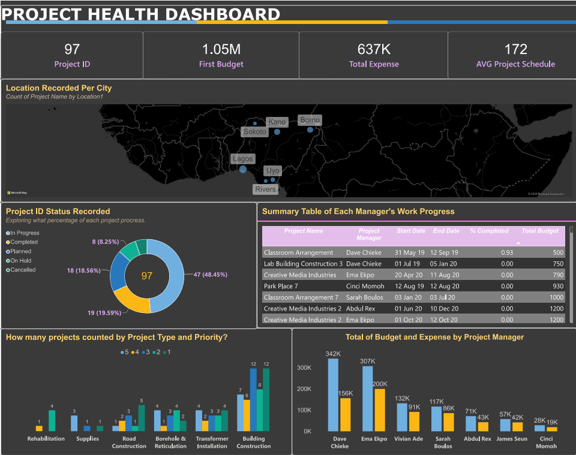

# PROJECT HEALTH DASHBOARD | 📑📊 POWER BI 📈📉

## Project Overview
This is one of my first Power BI dashboard and I'm excited to share it here!
I built this dashboard to bring project progress, track status, and record the company's budgets and expenses across projects managed by different managers. The main goal is to help managers and project teams review the rate of project progress, locations, priorities or even the completion percentages. 

It was created for PROJECT LOCATIONS, PROJECT #ID, TOTAL EXPENSE, PRIORITY, PROJECT ID STATUS that helpful to identifying whether the projects needs more attention

## Tools & Skills I Used:
- 🔋Power BI desktop: Built an attractive and appealing dashboard, applied core charts, converted data
- 💾Power Queries: Transformed data from raw file to categorize relevent columns and correct data types
- 📊Data visualization: Used 4 KPIs cads to display key metrics, utilized a map, a donut chart and bar charts to compare the difference of progress from each project managers.
- 🎨Dashboard Design: Visualized layouts, fill colors and labels cards to make the information in dashboard look easy and clean to read.

## Dashboard Preview:

📎[click here if you want to find the file of the dashboard: https://github.com/lamthy12/PowerBI_ProjectHealth/blob/main/ProjectManagment_LamThy.pbix]

## Closing Thoughts:
After completing this dashboard on Power BI, I had to learn how to prepare raw data and transform information into a visual report. This project provides me with practical skills, I used the built-in Power Query Editor to clean, custom and summarize data which these has eventually visualized data and enhance my business insights. 

Overall, the Power BI is one of a great tool for college students and future employees for me to study and build more interactive dashboard for business reports. This app is convenient and helpful for creating data visualizations in different styles, so people can access to data from anywhere on Power BI.

## Project Files & Sources:
- [You can find the Excel raw data file here](https://docs.google.com/spreadsheets/d/1Xk4YxG0RCCvnMvcDe2V2JobZB505eoe_0cW5LlJRvzI/edit?gid=1430517094#gid=1430517094)
